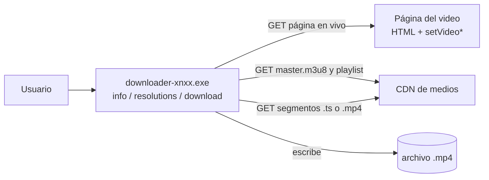
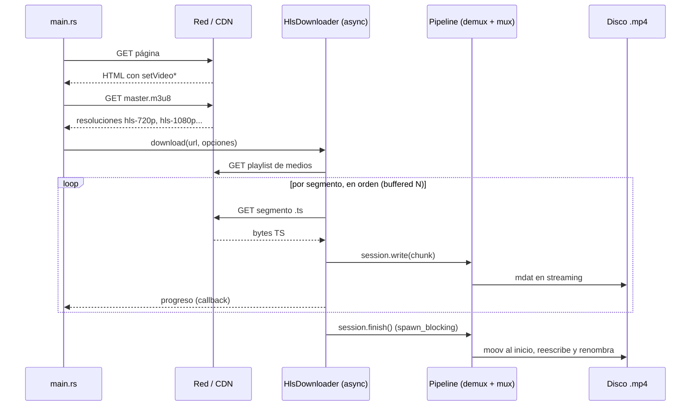
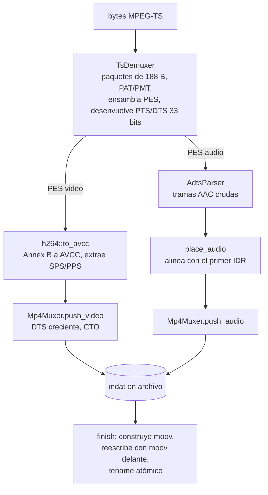

# Arquitectura

CLI en Rust que descarga videos MP4 directos o HLS (MPEG-TS con H.264 + AAC) y los guarda como MP4 **sin recodificar y sin herramientas externas** (nada de ffmpeg). El paquete (`downloader-xnxx`) contiene una **librería** (`src/lib.rs`, crate `downloader_xnxx`) y un **binario** (`src/main.rs`) que solo parsea argumentos, elige calidad y llama a la librería.

Runtime: `tokio` (multi-hilo) para la red, `reqwest` + `rustls` para HTTP, `clap` para la CLI. El remux es código síncrono propio.

## Contexto del sistema

## Módulos

| Módulo | Archivo | Responsabilidad |
| --- | --- | --- |
| CLI | `src/main.rs` | Subcomandos `info`, `resolutions`, `download`, `completions`. Menú de calidad (`dialoguer`) o `--best` / `--quality`. |
| Descargador | `src/download.rs` | `Downloader`: elige HLS o descarga directa por la URL (`.m3u8`). Borra el archivo parcial si hay error. |
| HLS | `src/hls.rs` | Lista de segmentos, descarga concurrente ordenada (`buffered`), reintentos y renovación de URLs firmadas. |
| HTTP | `src/http.rs` | `HttpClient` clonable (pool de conexiones, `rustls`). `try_get` sin validar status, `get` con validación. |
| Resoluciones | `src/player.rs` | Extrae `setVideoUrlLow/High/HLS(...)` con regex y parsea el master playlist a `hls-<alto>p`. |
| Metadatos | `src/video_info.rs` | Título, miniatura, descripción (Open Graph) y JSON-LD con `scraper`. |
| Nombres | `src/filename.rs` | Sanea títulos para Windows/Unix, evita nombres reservados, no pisa archivos (`nombre (1).mp4`). |
| Tipos y errores | `src/types.rs`, `src/error.rs` | `ProgressFn`, `UrlRefresher`, `DownloadedFile`; `Error` con `thiserror`. |
| Remux | `src/remux/` | MPEG-TS a MP4. Ver [Pipeline de remux](#pipeline-de-remux). |

El descargador HLS depende del trait `Remuxer` (inversión de dependencias), no de `NativeRemuxer` directamente.

## Flujo de datos (descarga HLS)

Descarga directa (`mp4-low`, `mp4-high`): `download_file` escribe el stream de bytes a un `BufWriter` de 256 KiB sin pasar por el remux.

## Pipeline de remux

Reglas relevantes:

- El video empieza en el primer IDR con SPS y PPS conocidos; el audio anterior se descarta.
- Solo se soportan H.264 y AAC (ADTS). Otros códecs devuelven `Error::UnsupportedCodec`.
- `finish` copia todo el archivo (faststart), por eso corre en `spawn_blocking`.
- Windows no permite reemplazar un archivo con handle abierto: se cierra antes del `rename`.

## Modelo de concurrencia

| Etapa | Dónde corre | Tipo de trabajo |
| --- | --- | --- |
| Descarga de segmentos | Futuros dentro de `buffered(N)` en un solo task | I/O (async) |
| Reintentos / renovación de URLs | Mismo task, `tokio::sync::Mutex` + contador de generación | I/O |
| `session.write` y `Pipeline::push` | **El mismo task que hace poll al stream** | CPU síncrono (demux, NALs, AVCC) |
| Escritura de `mdat` | `std::io::BufWriter<File>` síncrono, dentro de `push` | I/O de disco síncrono |
| `finish` (moov + reescritura) | `spawn_blocking` | CPU + disco |

Nota: `--threads` es la concurrencia de `buffered`, es decir, descargas en vuelo. **No son hilos del sistema operativo.**

### Hallazgo (hipótesis, sin medir)

`session.write(...)` es `async fn` pero su cuerpo es síncrono. Los futuros de `buffered` solo avanzan cuando se hace poll a `chunks.next()`, así que mientras un segmento se demuxea, las descargas en vuelo no progresan en ese task. Descarga y remux se alternan en vez de solaparse. El socket sigue recibiendo gracias a las tareas internas de hyper, pero el código no lo consume.

Antes de cambiar nada hay que medir cuánto tarda `Pipeline::push` por segmento frente a la descarga. Si es una fracción pequeña, el solapamiento no compensa la complejidad.

## Errores y reintentos

- Cada segmento: hasta `MAX_ATTEMPTS = 5` intentos con espera `500 ms * (intento + 1)`.
- `403` o `410` (URL firmada expirada): una sola tarea renueva la lista re-leyendo la página en vivo; las demás reutilizan el resultado (contador `generation`). Solo se acepta la lista nueva si tiene la misma cantidad de segmentos.
- Si falla la descarga o el remux, `Downloader::download` borra el archivo parcial.
- El error final conserva la causa: `Fallo segmento {index}: HTTP 403` o `error de red`.

## Build y release

- `release.ps1` (raíz del proyecto): compila en release, toma la ruta exacta del `.exe` de la salida JSON de cargo, valida la cabecera (MZ/ELF), copia a `dist/`, verifica SHA256, genera `SHA256SUMS.txt` y prueba el ejecutable con un PATH mínimo. Opciones: `-Zip`, `-Locked`, `-Strict`, `-Clean`, `-Bin`, `-OutDir`, `-Target`, `-NoOpen`.
- El target está compartido (`C:\Users\USUARIO\.cargo-target-shared`), no hay `target\` local. **`cargo clean` sin `-p` borraría el build de todos los proyectos.**
- Perfil release: `opt-level = 3`, `lto = "fat"`, `codegen-units = 1`, `strip = true`, `panic = "abort"`. Con `abort`, un pánico en cualquier hilo mata el proceso y `JoinHandle::join` nunca devuelve `Err`.
- Toolchain `x86_64-pc-windows-gnu`: la prueba de humo detecta DLLs de MinGW ausentes. Para distribuir, el target `x86_64-pc-windows-msvc` es el estándar.
- No compilar lo que se distribuye con `-C target-cpu=native`.

## Inconsistencias conocidas

| Dónde | Qué | Efecto |
| --- | --- | --- |
| `src/main.rs`, `completions` | Genera el autocompletado con el nombre `"video-dl"`, pero el binario es `downloader-xnxx` | Los scripts de autocompletado no coinciden con el ejecutable |
| `Cargo.toml` | Antes `name = "video-dl"`, ahora `downloader-xnxx` | Los `use` deben ser `downloader_xnxx::...`; una run configuration con `--package` viejo falla |
| `src/main.rs`, mensaje final | Imprime "mb" pero divide por 1024 * 1024 | Son MiB |

## Plan de práctica: hilos y rendimiento

Backlog de aprendizaje, **no implementado**:

| Ejercicio | Idea | Pregunta clave |
| --- | --- | --- |
| Pipeline con hilos | Descarga async, hilo de remux con `sync_channel(N)` | ¿Qué pasa con la memoria si el canal es ilimitado? ¿Cómo se entera el lado async de un `Err` del hilo y quién borra el `.mp4` parcial? |
| `thread::scope` | Parsear segmentos TS en paralelo y fusionar en orden | ¿Qué estado cruza segmentos (PTS/DTS, continuity counters, PES partidos)? |
| Progreso compartido | `Arc<AtomicU64>` frente a `Mutex` | ¿Cuándo basta `Relaxed` y cuándo hace falta `Release/Acquire`? |
| Pánicos | Diseñar errores con `Result` | Con `panic = "abort"`, `join` nunca ve el pánico |
| Cancelación | Ctrl+C con `AtomicBool` y limpieza del parcial | ¿Cómo drenar canales sin perder consistencia? |
| Falso compartido | Contadores por hilo contiguos frente a `#[repr(align(64))]` | ¿Cuánto cuesta una línea de caché compartida? |

Benchmarks con Criterion (la librería ya expone las funciones públicas):

| Tema | Candidato en el código |
| --- | --- |
| Branch prediction / SIMD | `split_nals` y el escaneo de sincronía `0x47` en `TsDemuxer::push` frente a `memchr` |
| Loop unrolling / LLVM | Recorrido por paquetes con `chunks_exact(188)`, revisar con `cargo asm --release` |
| Caché | `WRITE_BUFFER` (256 KiB) y `COPY_BUFFER` (1 MiB) |
| Copias y asignaciones | `data.to_vec()` en `flush`, `to_vec()` por trama en `AdtsParser`, `Vec` de salida en `to_avcc` |

Reglas de medición: `Throughput::Bytes`, `black_box`, un `.ts` real como fixture y siempre en release.

## Cómo se verificó

- `release.ps1`: 49 comprobaciones automáticas con PowerShell 7 en Linux (rutas con espacios, target compartido, workspaces, errores de compilación, binario bloqueado, `-Zip`, `-Locked`, entre otras). **No probado en Windows ni en PowerShell 5.1.**
- Esta arquitectura se redactó leyendo el código fuente. El hallazgo de concurrencia y los diagramas no se midieron ni ejecutaron en una descarga real.
